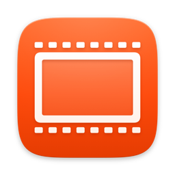

<p align="center">
  
</p>

<h1 align="center">Darkroom</h1>

<p align="center"><b>A darkroom for your digital photos.</b><br>
Cull on a contact sheet, finish every frame in your own film look, and build bodies of work.<br>
Free and open source, for macOS.</p>

<p align="center">
  <a href="#install">Install</a> ·
  <a href="#what-you-get">What you get</a> ·
  <a href="#how-you-work">How you work</a> ·
  <a href="#free-and-open-source">Free and open source</a>
</p>

---

## Install

Paste this into Terminal:

```bash
/bin/bash -c "$(curl -fsSL https://raw.githubusercontent.com/TrentM6/darkroom/main/install.sh)"
```

That's it. In a few minutes Darkroom opens and walks you through setup. It's a fresh, empty library of your own: nothing to sign up for, no account, no subscription.

<sub>macOS 14 or later. Apple Silicon installs a ready-made app; Intel Macs build from source automatically.</sub>

---

## What you get

**📼 Contact sheets.** Every shoot opens as 35 mm film strips, with sprocket holes and an edge print that reads your camera and film stock. Mark keepers with a red grease pencil: a loop for a select, a star for your best.

**🎞️ Your look, on every photo.** Every frame opens already finished in **My Look**: a film stock (Kodachrome, Portra, Ektar, Ilford HP5 and more) with your contrast, colour and grain. My Look learns from the photos you mark as your best, so it grows with you.

**🎚️ Real editing.** Light, colour, film, punch, vignette, grain, straighten and crop, with a live preview while you drag. A full-quality render follows a moment later. **Colour Balance** fixes casts that differ between the shadows and the highlights, like the blue-green shadows and pink highlights of film scans, and **Neutralize** finds them for you.

**🗂️ Bodies of work.** Put frames from any shoot into **collections** ("New York Street", "Portraits 2026"), sequence them by dragging, and export the whole set to a new folder with or without a white frame.

**🧠 A panel of masters (optional).** Connect an AI and ask for a critique of any photo, judged by a panel of photographers you choose: New York Street, Colour Masters, Black-and-White Street, Documentary and more, or your own pick from 36 photographers. You get honest notes on the picture and the print, with a fix for every problem. It works with Claude Code, or your own Anthropic or OpenAI API key.

**🔒 Your photos stay put.** Darkroom never copies, moves or changes your originals. It reads them where they are and keeps only a small catalog of your edits and marks on your Mac. Nothing leaves your computer, unless you ask the optional AI about a photo.

---

## How you work

1. **Attach a folder** of shoots. Each folder of photos becomes a project, and new photos appear as you add them.
2. **Cull** on the contact sheet. <kbd>P</kbd> picks a select, <kbd>X</kbd> rejects, <kbd>Space</kbd> looks closer.
3. **Mark your best** with <kbd>F</kbd>. Best Work gathers them from every shoot, and teaches My Look.
4. **Finish** anything that needs it in the editor. Copy and paste settings across a roll.
5. **Build collections.** Press <kbd>B</kbd> to add frames to a body of work, then export it as one folder.

All Selects and Best Work collect across every project, and a badge shows which collection each photo is already in.

---

## Free and open source

Darkroom is **MIT licensed**: free to use, free to change, free to share. Fork it, restyle it, add the film stocks or tools you want, and build your own version. There's no account and no tracking.

Every install is its own clean instance: your library, your look, your settings. Nothing is shared between installs.

---

## Good to know

- **Formats:** JPEG and TIFF, from your camera or your scans. RAW files are not read yet.
- **Rendering** uses [RawTherapee](https://rawtherapee.com), the open-source raw processor, which the installer sets up for you (from rawtherapee.com, signature-checked), along with its film simulation library.
- **Updating:** run the install command again. Your library is never touched.
- **Why a Terminal command?** The app isn't signed with an Apple Developer ID, so a download from a browser would be blocked by macOS. The installer checks the download's checksum and signature instead.
- **Where things live:** your catalog in `~/Library/Application Support/Baseline Darkroom/`, a self-trimming preview cache in `~/Library/Caches/Baseline Darkroom/`, exports on your Desktop.

---

## For developers

<details>
<summary>Build from source, project layout, releases</summary>

### Build from source

Requirements: macOS 14+, Swift 5.10+ (Xcode or the Command Line Tools), [RawTherapee 5.11](https://rawtherapee.com) in `/Applications`, and RawTherapee's Film Simulation Collection (`HaldCLUT.zip`) unpacked into `photolab/luts/`. Copy `rawtherapee-cli` from `RawTherapee.app/Contents/MacOS/` into `photolab/bin/`.

```bash
cd photolab
scripts/build-app.sh        # builds, assembles and installs ~/Applications/Baseline Darkroom.app
```

Or let the installer build from source: `DARKROOM_FROM_SOURCE=1` (any Mac), or `DARKROOM_SRC=<checkout>` to build an existing checkout.

Run the server with the UI served live from source, then open `http://127.0.0.1:8765/`:

```bash
~/Library/Developer/BaselineDarkroom/build/release/photolab studio --port 8765 --ui photolab/Sources/PhotoLabCore/Resources/studio
```

`PHOTOLAB_LIBRARY_ROOT=<folder>` keeps the catalog, cache and logs under that folder: a separate test library that never touches your own.

### How it's built

```
Baseline Darkroom.app (AppKit window + WKWebView)
   ▼
photolab studio server (Swift, 127.0.0.1 only)
   ├─ live folders → analysis (Swift + Apple Vision, on the Mac)
   ├─ edit engine: parameters → RawTherapee profiles → rawtherapee-cli, + colour balance, grain, frame
   ├─ My Look (learned from Best Work), collections, optional AI critique
   └─ HTTP API + the studio UI (plain HTML/CSS/JS modules, no build step; WebGL2 preview)
```

| Path | What |
|---|---|
| `photolab/Sources/PhotoLabCore/` | Analysis, edit engine, studio backend (`Studio*.swift`) |
| `photolab/Sources/PhotoLabCore/Resources/studio/` | The UI, and `changelog.json` (notes for the in-app update panel) |
| `photolab/Sources/PhotoLabApp/`, `photolab/Sources/photolab/` | Mac app shell; command-line tool and server |
| `photolab/scripts/` | `build.sh`, `build-app.sh`, `release.sh` |
| `install.sh` | The one-command installer and updater |

### Publishing a release

```bash
photolab/scripts/release.sh
gh release create v1.0 dist/Baseline-Darkroom-macOS-arm64.zip dist/Baseline-Darkroom-macOS-arm64.zip.sha256
```

`release.sh` builds from a clean export of the commit, refuses anything that may not be redistributed, and puts the licences inside the app. The installer picks up the newest release.

</details>

---

## Third-party

Full notices are in [`THIRD_PARTY_NOTICES.md`](THIRD_PARTY_NOTICES.md), which also ships inside the app.

- **RawTherapee** (GPL-3.0) runs as a separate program; it isn't linked or included. The installer downloads the official signed build.
- **RawTherapee Film Simulation Collection** (CC BY-SA 4.0) by Pat David, Pavlov Dmitry and Michael Ezra, downloaded by the installer. Film stock names identify the stocks the LUTs approximate; Darkroom isn't affiliated with their owners.
- **Geist** fonts (SIL Open Font License) and **Lucide** icons (ISC) are included.

## License

[MIT](LICENSE). Made by Baseline.
